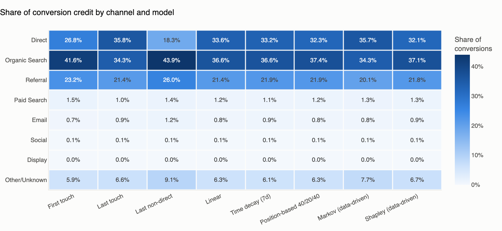
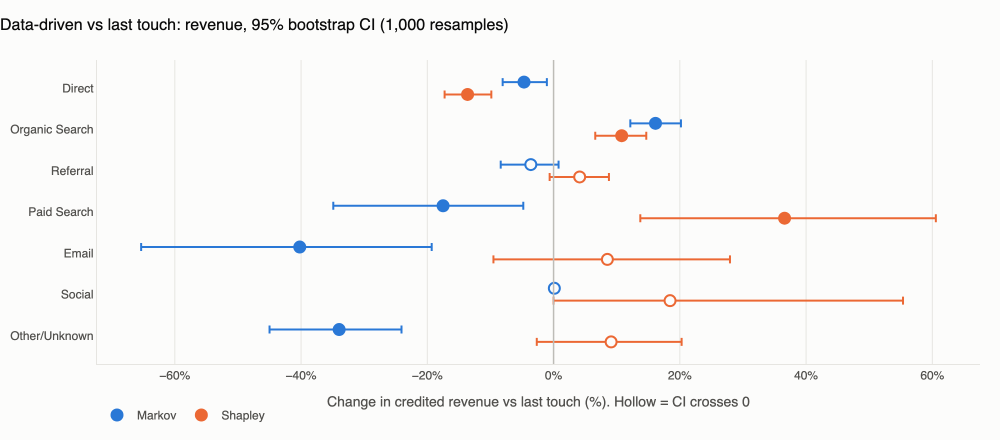
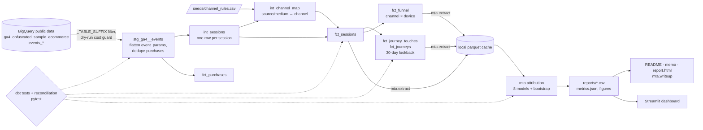
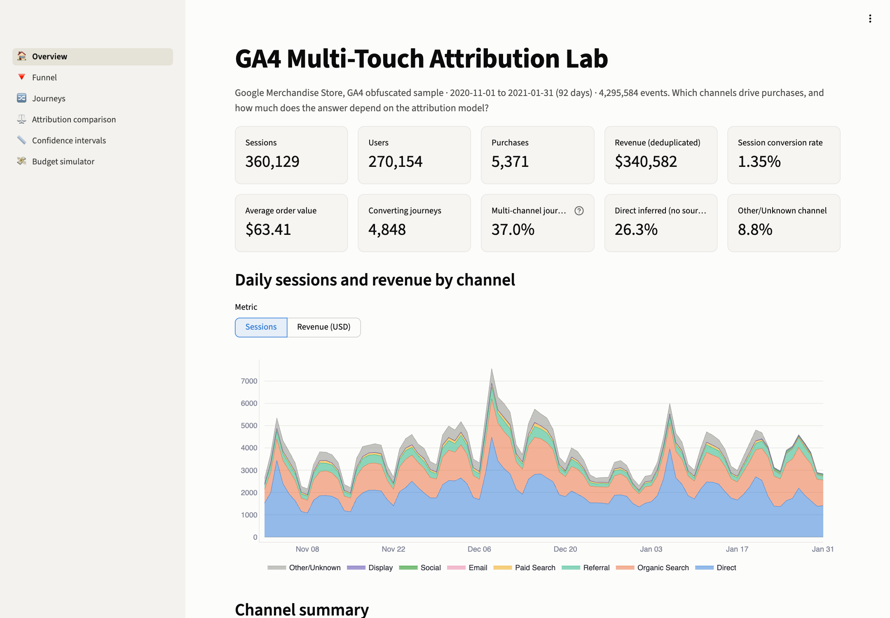
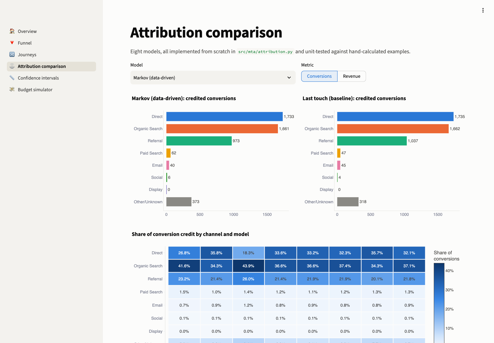
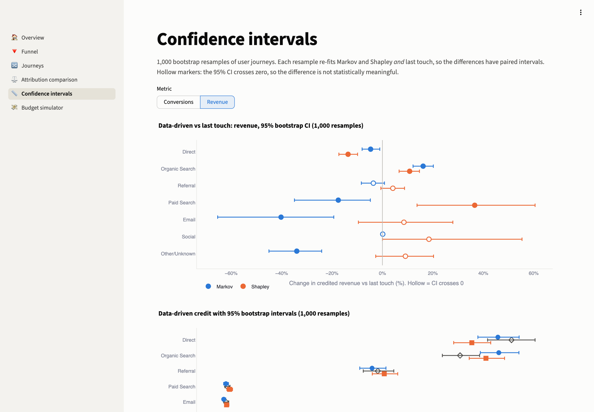
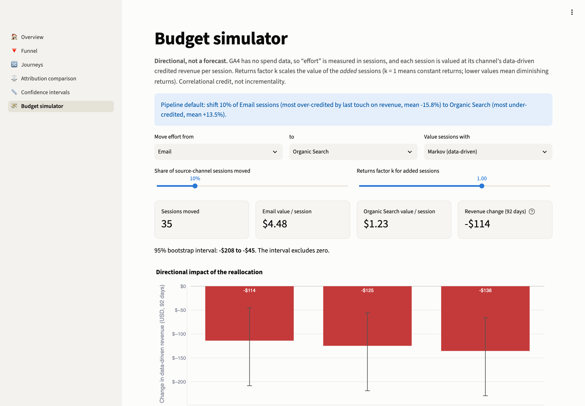
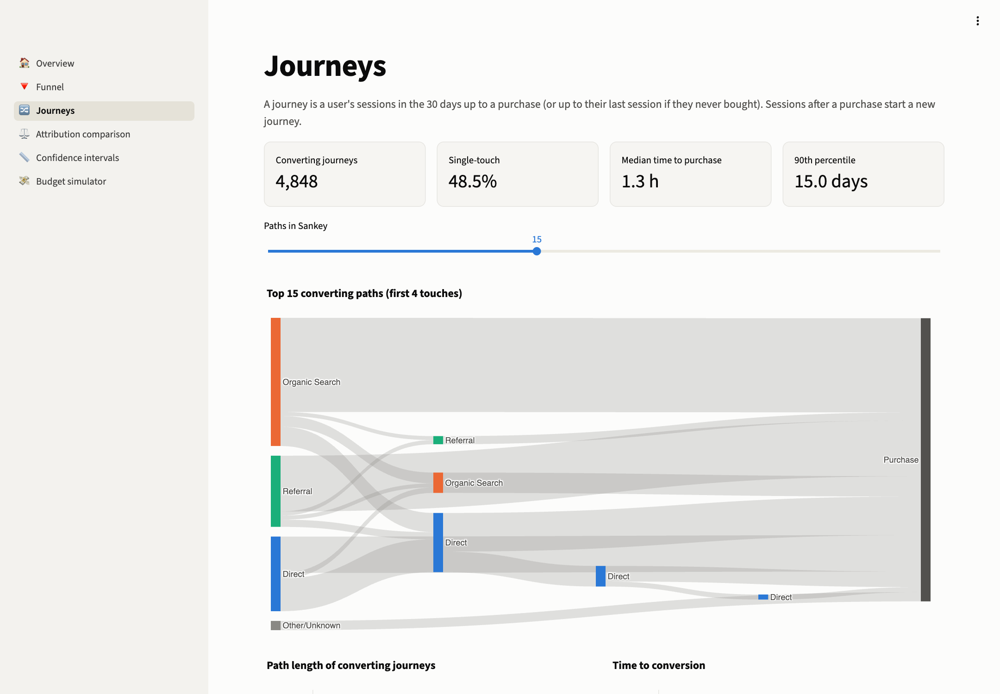
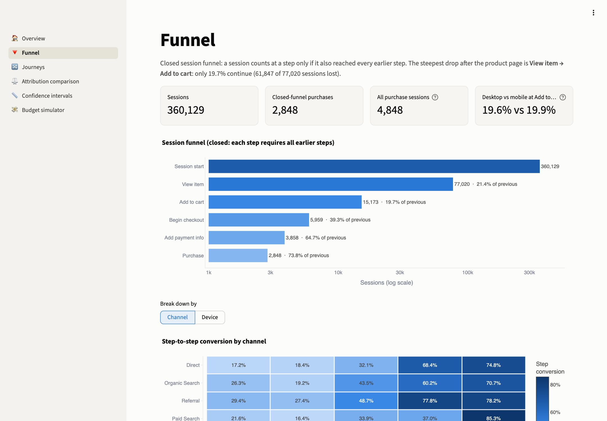

# GA4 Multi-Touch Attribution Lab

**Which marketing channels actually drive purchases, how much does the answer change with the attribution
model, and where should budget move?** This project answers that for the Google Merchandise Store using
92 days of raw GA4 event data (4,295,584 events, 360,129 sessions). BigQuery and dbt
turn the events into sessions, channels and 272,792 30-day user journeys. Eight attribution models
are implemented from scratch in Python, including Markov-chain removal effects and exact Shapley values,
and compared with 1,000-resample bootstrap confidence intervals. The results feed a funnel
analysis, a budget-reallocation simulator, a Streamlit dashboard and a one-page memo for a marketing
director. Every number below is generated by the code in this repo.

## Key findings

1. **Organic Search is worth more than last-click reporting shows.** Both data-driven models give Organic Search more revenue credit than last touch: $109,173 → $126,801 (Markov, +16.1%) and $120,953 (Shapley, +10.8%); both 95% intervals exclude zero. It opens 41.6% of converting journeys but closes only 34.3%.
2. **Direct gets too much credit, and half of it is really missing tracking.** Direct loses revenue credit under both data-driven models (-4.7% Markov, -13.6% Shapley; both significant). 50% of Direct's 188,830 sessions carry no source information at all, and under last non-direct click its share of conversions falls from 35.8% to 18.3%.
3. **Paid Search assists more sales than it gets credit for, but each visit is worth the least.** Paid Search is the only channel both data-driven models agree last touch under-credits on conversions: 47 → 62.4 (Markov, +32.9%) and 61.1 (Shapley, +29.9%). Even so, it earns $0.33/session vs $1.23 for Organic Search and $2.55 for Referral (Markov).
4. **Moving budget toward the "under-credited" channel would lose money here.** Shifting 10% of Email effort (35 sessions) to Organic Search changes data-driven revenue by -$114 over 92 days (95% CI -$208 to -$45), even with constant returns. Email still earns $4.48/session vs $1.23.
5. **The biggest leak is the product page, not checkout, and it isn't a mobile problem.** Only 19.7% of sessions that view a product add it to the cart (61,847 of 77,020 sessions drop). Once checkout starts, 64.7% add payment info and 73.8% of those buy. Desktop (19.6%) and mobile (19.9%) add to cart at the same rate (p = 0.28).

Full write-up for a non-technical audience: [`docs/findings_memo.md`](docs/findings_memo.md) ·
Data profile: [`docs/data_profile.md`](docs/data_profile.md) · Static report: [`reports/report.html`](reports/report.html)

### Credited conversions by model

| channel        |   First touch |   Last touch |   Last non-direct |   Linear |   Time decay (7d) |   Position-based 40/20/40 |   Markov (data-driven) |   Shapley (data-driven) |
|:---------------|--------------:|-------------:|------------------:|---------:|------------------:|--------------------------:|-----------------------:|------------------------:|
| Direct         |       1,301.0 |      1,735.0 |             886.0 |  1,630.0 |           1,612.0 |                   1,566.7 |                1,732.5 |                 1,556.4 |
| Organic Search |       2,019.0 |      1,662.0 |           2,128.0 |  1,773.1 |           1,775.3 |                   1,811.6 |                1,660.9 |                 1,799.1 |
| Referral       |       1,125.0 |      1,037.0 |           1,261.0 |  1,038.9 |           1,061.8 |                   1,062.0 |                  972.9 |                 1,058.6 |
| Paid Search    |          75.0 |         47.0 |              67.0 |     56.5 |              54.0 |                      59.0 |                   62.4 |                    61.1 |
| Email          |          35.0 |         45.0 |              60.0 |     40.8 |              45.1 |                      40.1 |                   40.1 |                    44.5 |
| Social         |           5.0 |          4.0 |               5.0 |      4.5 |               4.5 |                       4.5 |                    5.7 |                     4.5 |
| Display        |           0.0 |          0.0 |               0.0 |      0.0 |               0.0 |                       0.0 |                    0.3 |                     0.0 |
| Other/Unknown  |         288.0 |        318.0 |             441.0 |    304.3 |             295.4 |                     304.1 |                  373.1 |                   323.8 |

### Revenue credit: data-driven vs last touch

| channel        | Last touch   | Markov   | Shapley   | Markov vs LT   | Shapley vs LT   | Verdict (95% bootstrap)      |
|:---------------|:-------------|:---------|:----------|:---------------|:----------------|:-----------------------------|
| Direct         | $132,592     | $126,384 | $114,529  | -4.7%          | -13.6%          | over-credited by last touch  |
| Organic Search | $109,173     | $126,801 | $120,953  | +16.1%         | +10.8%          | under-credited by last touch |
| Referral       | $71,696      | $69,112  | $74,660   | -3.6%          | +4.1%           | no significant difference    |
| Paid Search    | $3,114       | $2,569   | $4,254    | -17.5%         | +36.6%          | mixed: models disagree       |
| Email          | $2,628       | $1,571   | $2,852    | -40.2%         | +8.5%           | mixed: models disagree       |
| Social         | $84          | $84      | $99       | +0.1%          | +18.5%          | no significant difference    |
| Display        | $0           | $0       | $0        | n/a            | n/a             | no significant difference    |
| Other/Unknown  | $21,295      | $14,061  | $23,236   | -34.0%         | +9.1%           | mixed: models disagree       |




## Architecture



## Dashboard

| Overview | Attribution comparison |
|---|---|
|  |  |
| **Confidence intervals** | **Budget simulator** |
|  |  |
| **Journeys (Sankey)** | **Funnel** |
|  |  |

## How to run

Prerequisites: Python 3.11, a Google Cloud project with BigQuery enabled (the free Sandbox works), and the
`gcloud` CLI.

```bash
gcloud auth application-default login     # credentials via ADC, no key files
cp .env.example .env                       # set GCP_PROJECT_ID
make setup                                 # venv + pinned requirements
make all                                   # profile → dbt build (+tests) → extract → models → write-ups
make dashboard                             # http://localhost:8501
```

The last full `make all` processed 13.6 GB in BigQuery, measured from job statistics (the free tier is 1 TB/month). Every
query is dry-run first and refused above a per-query byte cap. Other targets: `make test` (pytest + dbt tests),
`make dryrun` (bytes per compiled model), `make screenshots`.

> **BigQuery Sandbox note:** the Sandbox expires tables after 60 days and partitions dated more than 60 days ago
> immediately, which is why `stg_ga4__events` is clustered, not date-partitioned. Re-running `make all` rebuilds
> everything if the tables have expired.

## Method notes

- **Sessions and channels.** A session's source/medium is taken from the first event in that session
  that carries the `source`/`medium` event params. The `traffic_source` struct is user-level first touch, so it isn't used.
  Channels come from an ordered regex rules table (`dbt/seeds/channel_rules.csv`) with a rationale for every rule.
  26.3% of sessions carry no source params and follow GA4's
  `(direct)` convention, flagged `source_inferred`. Self-referrals from the store's own domains are treated as Direct.
- **Journeys.** These are a user's sessions in the 30 days before a purchase (lookback is a dbt var). Sessions after a purchase
  start a new journey, and journeys without a purchase end at the user's last session.
- **Models.** First touch, last touch, last non-direct, linear, time decay (7-day half-life, parameterised),
  position-based 40/20/40, **Markov** (first-order, removal effects solved exactly from the absorbing chain),
  and **Shapley** (exact 2ⁿ enumeration, v(S) = conversions from journeys whose channel set ⊆ S).
  Every model has a hand-calculated unit test.
- **Uncertainty.** 1,000 bootstrap resamples of journeys, implemented as multinomial reweighting of unique
  (path, outcome, revenue) groups, which is exactly equivalent to resampling journeys and runs in seconds. Last touch is
  re-fit on each replicate, so "data-driven minus last touch" gets a paired interval. A channel is called over- or
  under-credited only if **both** data-driven models differ significantly in the same direction.
- **Data quality.** dbt tests (not_null, unique, accepted_values, relationships) plus custom checks: revenue
  reconciles between raw events and three modeled tables within 0.5%, no negative session durations, and
  purchase counts match across layers. The build fails on any of them. 321 duplicate
  purchase events (a double-firing tag, $21,583 or 6.0% of gross revenue) are
  removed, and the reconciliation recomputes that rule directly from raw events.

## Repository layout

```
dbt/        models (staging → intermediate → marts), seeds/channel_rules.csv, tests/ (custom checks)
src/mta/    bq.py (cost-guarded client) · profile.py · extract.py · attribution.py · analysis.py · viz.py · writeup.py
tests/      pytest unit tests for every attribution model
dashboard/  Streamlit app (6 pages)
docs/       data_profile.md · findings_memo.md · screenshots/
reports/    CSV outputs, metrics.json, figures/, report.html
```

## What I'd do next

1. **Incrementality.** Run a geo or audience holdout for Paid Search and Email to check whether the
   data-driven credit matches causal lift.
2. **Add cost data** (Google Ads, ESP exports) so the simulator optimises revenue per dollar instead of per session,
   with channel saturation curves in place of the constant k factor.
3. **Higher-order Markov and a learned-value Shapley** (conversion-probability characteristic function) to test
   how sensitive the conclusions are to model assumptions.
4. **Sensitivity of the Direct assumption.** Re-run with parameter-less sessions as Unknown instead of Direct.
5. **Schedule it.** Run as an incremental dbt model on a live GA4 export, with Airflow/Cloud Scheduler and data
   freshness tests.
